# 🍾 PULSE — Industrial Bottling Plant SCADA & Real-Time Analytics Platform

[](https://www.python.org/)
[](https://flask.palletsprojects.com/)
[](https://react.dev/)
[](https://tailwindcss.com/)
[](https://threejs.org/)
[](https://www.mysql.com/)
[](https://aistudio.google.com/)
[](https://www.deltaww.com/)
[](https://en.wikipedia.org/wiki/Argon2)
[](LICENSE)

> **PULSE** is a full-stack Industry 4.0 SCADA platform, IoT telemetry pipeline, and predictive manufacturing intelligence suite engineered for high-speed automated liquid bottling lines. Bridging physical factory-floor programmable logic controllers (PLCs) with executive decision intelligence, PULSE synchronizes sub-second industrial sensor acquisition with a luxury macOS-inspired glassmorphism Human-Machine Interface (HMI), multi-tiered Role-Based Access Control (RBAC), an interactive Three.js 3D kinetic digital twin, and an autonomous Google Gemini AI industrial agent.

---

## 📌 Executive Summary for Technical Interviewers

| Dimension | Engineering Implementation |
|---|---|
| **Industrial SCADA Layer** | Delta DIAView SCADA running an asynchronous, non-blocking 100ms VBScript state machine interfacing physical optical sensors, Mettler Toledo load cells, Keyence cappers, and Festo pneumatic reject diverters. |
| **Data Ingestion Pipeline** | Real-time ADO `DbAccess.DatabaseAccess` pipeline persisting high-frequency sensor events into MySQL 8.0 with indexed bottle serials, timestamps, and active batch identifiers. |
| **Backend Microservice** | Python Flask 3.0 RESTful service architected with connection pooling, PyMySQL, modular blueprints, and deterministic time-series aggregation engines. |
| **Frontend Architecture** | React 19, TypeScript, and Tailwind CSS v4 featuring an Apple/macOS-inspired glassmorphism design system (`backdrop-filter: blur(16px)`), Recharts SVG telemetry waves, and motion physics. |
| **Kinetic 3D Digital Twin** | Three.js WebGL canvas featuring an atmospheric Japanese Torii gate and kinetic conveyor transport line, rendering spatial assets at 60 FPS. |
| **Autonomous AI Copilot** | Google Gemini 2.5 Flash integrated via a **ReAct (Reasoning + Acting) Tool-Calling Pattern** across 12 deterministic Python plant tools (`ai_tools.py`) with zero hallucination risk. |
| **Enterprise Security & RBAC** | Memory-hard Argon2id password hashing, HMAC-SHA256 JWT tokens, 5-tier role hierarchy, protected Owner immutability, in-memory heartbeat write-throttling (30s), and immutable audit logs. |

---

## 📑 Table of Contents

1. [System Architecture & Data Pipeline](#-system-architecture--data-pipeline)
2. [UI/UX Design Philosophy & Modern Industrial HMI](#-uiux-design-philosophy--modern-industrial-hmi)
3. [Visual Tour: Complete 12-Screen Platform Walkthrough](#-visual-tour-complete-12-screen-platform-walkthrough)
   - [1. Industrial Landing & Cinematic Presentation Hero](#1-industrial-landing--cinematic-presentation-hero)
   - [2. Secure Aurora Identity & Access Gateway](#2-secure-aurora-identity--access-gateway)
   - [3. SCADA Central Command Overview Dashboard](#3-scada-central-command-overview-dashboard)
   - [4. Autonomous AI Plant Insights Copilot](#4-autonomous-ai-plant-insights-copilot)
   - [5. Production Wave & Batch Quota Fulfillment](#5-production-wave--batch-quota-fulfillment)
   - [6. High-Granularity Bottle Serialization & Tracking](#6-high-granularity-bottle-serialization--tracking)
   - [7. Station 2: Optical & Load-Cell Quality Inspection](#7-station-2-optical--load-cell-quality-inspection)
   - [8. Station 4: Automated Capping & Torque Operations](#8-station-4-automated-capping--torque-operations)
   - [9. Station 5: Automated 3-Bottle Tray Packaging Line](#9-station-5-automated-3-bottle-tray-packaging-line)
   - [10. Full-Fidelity Production History & Telemetry Logs](#10-full-fidelity-production-history--telemetry-logs)
   - [11. Enterprise RBAC User Directory & Security Governance](#11-enterprise-rbac-user-directory--security-governance)
   - [12. Plant Reports, Defect Analytics & Automated PDF Engine](#12-plant-reports-defect-analytics--automated-pdf-engine)
4. [Industrial Hardware & SCADA Integration](#-industrial-hardware--scada-integration)
5. [Autonomous Google Gemini AI Copilot (ReAct Agent)](#-autonomous-google-gemini-ai-copilot-react-agent)
6. [Enterprise Security & RBAC Architecture](#-enterprise-security--rbac-architecture)
7. [Database Schema & Telemetry Modeling](#-database-schema--telemetry-modeling)
8. [Architectural Deep Dives & Interview Q&A](#-architectural-deep-dives--interview-qa)
9. [Project Directory & Codebase Anatomy](#-project-directory--codebase-anatomy)
10. [Getting Started & Installation Guide](#-getting-started--installation-guide)
11. [REST API Specification](#-rest-api-specification)
12. [Safe Push & Deployment Checklist](#-safe-push--deployment-checklist)

---

## 🏛 System Architecture & Data Pipeline

PULSE solves the legacy manufacturing disconnect by decoupling physical sensor acquisition from real-time browser rendering while preserving millisecond synchronization across the plant.

```
┌─────────────────────────────────────────────────────────────────────────────────┐
│                           PHYSICAL BOTTLING LINE                                │
│   [Infeed Sensor] ──> [Load-Cell Scale] ──> [Reject Gate] ──> [Capper] ──> [Box]│
└────────────────────────────────────────┬────────────────────────────────────────┘
                                         │ Electrical Signals (DI/DO/AI)
                                         ▼
┌─────────────────────────────────────────────────────────────────────────────────┐
│                         DELTA DIAVIEW SCADA ENGINE                              │
│   - 100ms High-Frequency TimeScript_Tick Event Loop                             │
│   - Sensor Rising-Edge Detector & Asynchronous SQL Query Staging                │
│   - Non-Blocking Execution via DbAccess.DatabaseAccess Driver                   │
└────────────────────────────────────────┬────────────────────────────────────────┘
                                         │ Non-Blocking SQL Streams
                                         ▼
┌─────────────────────────────────────────────────────────────────────────────────┐
│                           MYSQL 8.0 TIME-SERIES DB                              │
│   - production_summary (High-level line accumulators & yields)                  │
│   - production_log     (Individual bottle serial records & quality states)      │
│   - production_batch   (Active target quotas & fulfillment timelines)           │
│   - users              (Argon2id credential store & active session states)      │
│   - user_audit_log     (Immutable administrative & security event log)          │
└──────────────────┬───────────────────────────────────────────────┬──────────────┘
                   │                                               │
                   ▼                                               ▼
┌──────────────────────────────────────┐       ┌──────────────────────────────────┐
│        PYTHON FLASK 3.0 API          │       │      GOOGLE GEMINI 2.5 FLASH     │
│ - PyMySQL Connection Pool            │       │ - ReAct Autonomous AI Agent      │
│ - HMAC-SHA256 JWT Auth Layer         │◄─────►│ - 12 Deterministic Plant Tools   │
│ - 5-Tier RBAC Access Middleware      │       │ - Zero-Hallucination Querying    │
│ - Sub-Second Telemetry Aggregators   │       │ - Natural Language Forecasting   │
└──────────────────┬───────────────────┘       └──────────────────────────────────┘
                   │ RESTful JSON Endpoints
                   ▼
┌─────────────────────────────────────────────────────────────────────────────────┐
│                           REACT 19 + VITE FRONTEND                              │
│ - macOS-Inspired Glassmorphism Interface (Backdrop-filter blur & ambient light) │
│ - Kinetic Three.js WebGL Digital Twin (Torii gate & conveyor kinematics)        │
│ - Interactive Recharts SVG Telemetry Waves & Dual-Layer Donut Rings             │
│ - Client-Side jsPDF Shift Summary & Executive Audit Report Generator            │
└─────────────────────────────────────────────────────────────────────────────────┘
```

### End-to-End Telemetry Lifecycle:
1. **Physical Sensor Event**: An infeed bottle crosses Station 2's Mettler Toledo load cell. Analog gross weight readings are evaluated against the 500g nominal standard.
2. **SCADA Edge Sequencer**: Delta DIAView's VBScript tick detects the sensor rising edge, calculates pass/reject status, and queues an asynchronous SQL record without halting the physical line.
3. **Database Persistence**: The record is committed to MySQL `production_log` with bottle ID, timestamps, inspection results, and weight categorization.
4. **API Normalization**: Flask 3.0 transforms raw SQL time-series records into structured JSON payloads, computing real-time defect rates, packaging efficiencies, and batch pacing.
5. **Client Presentation**: React 19 UI receives telemetry, animating live SVG counters (`AnimatedNumber.tsx`), updating the yield distribution donut, and refreshing Recharts throughput curves.
6. **AI Context Grounding**: When an operator queries the AI, Google Gemini dynamically executes `get_bottle_details()` or `get_production_summary()` to deliver grounded, hallucination-free answers.

---

## 🎨 UI/UX Design Philosophy & Modern Industrial HMI

Traditional industrial SCADA interfaces (Siemens WinCC, Wonderware, Rockwell FactoryTalk) suffer from severe design debt: 1990s gray-box styling, harsh neon warning states, cramped layouts, and excessive visual noise. In a high-speed packaging environment running thousands of units per hour, visual fatigue leads directly to missed defects and delayed emergency interventions.

PULSE completely reimagines industrial HMI by applying **luxury consumer-grade software principles (Apple macOS / VisionOS)** to factory floor operations:

```
┌────────────────────────────────────────────────────────────────────────────────┐
│                           PULSE DESIGN PRINCIPLES                              │
├─────────────────────────┬─────────────────────────┬────────────────────────────┤
│   Atmospheric Depth     │   Ergonomic Lighting    │     Cognitive Pacing       │
│ Frosted glass surfaces  │ Deep navy canvas        │ Dual-layer concentric ring │
│ (16px backdrop blur)    │ (#0a0f1d) engineered    │ gauges and live sparklines │
│ with 1px specular edges │ for 12-hour operator    │ prioritize anomalies       │
│ eliminate boxy clutter. │ shift fatigue reduction.│ without alarms blinding op.│
└─────────────────────────┴─────────────────────────┴────────────────────────────┘
```

### 1. Glassmorphism & Atmospheric Staging
* **Backdrop Filters**: Utilizing CSS `backdrop-filter: blur(16px)` combined with semi-transparent tinted glass (`rgba(15, 23, 42, 0.65)`). Panels float gracefully above ambient background scenes without obstructing spatial depth.
* **Specular Borders**: 1px inner strokes (`rgba(255, 255, 255, 0.08)`) simulate light refraction along card perimeters, establishing crisp visual hierarchy across dense data grids.

### 2. ISO 9001 Semantic Color Architecture
Industrial instrumentation requires immediate, unambiguous state recognition adhering to WCAG 2.1 AA contrast standards:
* 🟢 **Nominal / Passed (`#10B981`)**: Reflects certified ISO 9001 compliance, weight tolerance adherence, and secure cap torque.
* 🔴 **Defect / Rejected (`#EF4444`)**: Highlights pneumatic diverter actuation, under-filled bottles, and loose cap seals.
* 🟡 **Warning / Pending (`#F59E0B`)**: Denotes bottles in transit between inspection and capping, or calibration threshold warnings.
* 🔵 **Active Quota (`#06B6D4` / `#3B82F6`)**: Indicates active batch pacing, run velocities, and synchronized sensor streams.

### 3. Kinetic 3D Digital Twin (Torii Gate & Conveyor Concept)
* The entry hero integrates an interactive **Three.js WebGL canvas** juxtaposing traditional Japanese Torii architecture with kinetic industrial transport mechanics.
* Symbolizes the synthesis of precision craftsmanship and modern automated robotics, transforming a standard internal tool into an investor-ready presentation portal.

---

## 📸 Visual Tour: Complete 12-Screen Platform Walkthrough

Below is a detailed visual tour of the 12 core interfaces comprising the PULSE Bottling Plant Platform, detailing how each screen works and the design decisions behind it.

---

### 1. Industrial Landing & Cinematic Presentation Hero

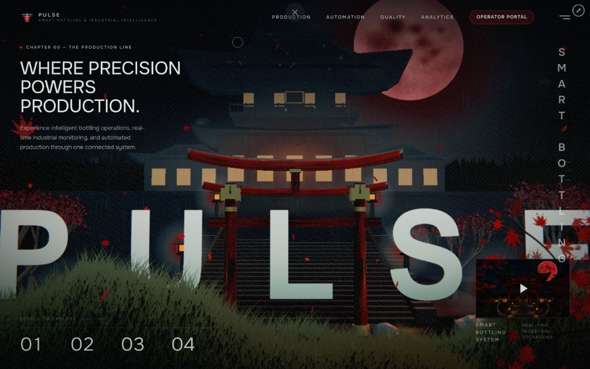

* **Route**: `/` or `/kage`
* **How It Works**:
  * An interactive **Three.js WebGL canvas** renders a cinematic nighttime industrial landscape featuring an illuminated Torii gate, moonlit horizon, and kinetic particle system representing material flow.
  * Chapter navigation (`01 Production`, `02 Automation`, `03 Quality`, `04 Analytics`) allows visitors and executives to explore the digital twin sequentially.
  * Direct action buttons offer one-click access into the secure **Operator Portal** and real-time SCADA telemetry dashboards.
* **Design Rationale**:
  * Replaces sterile industrial documentation with an evocative digital twin aesthetic, conveying precision engineering, balance, and modern craftsmanship.

---

### 2. Secure Aurora Identity & Access Gateway

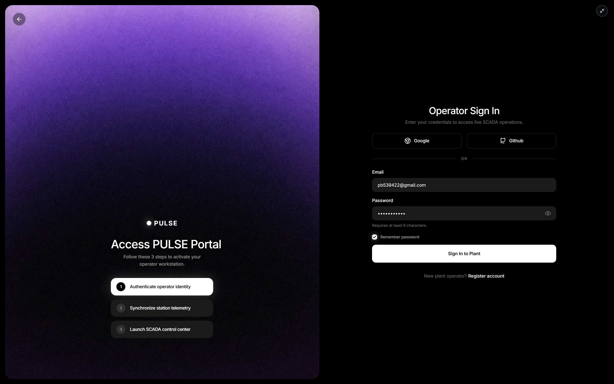

* **Route**: `/login`
* **How It Works**:
  * Authenticates operators, supervisors, and plant managers against the MySQL user directory using memory-hard **Argon2id** password verification.
  * Features credential memory toggles, dual login options (Password / Passkey SSO), and returns a signed HMAC-SHA256 JWT bearer token stored securely on the client.
  * Role-aware automatic redirection routes users directly to their authorized operational dashboard views.
* **Design Rationale**:
  * Designed with an ambient purple-violet aurora glow and frosted glass card, creating a modern, frictionless sign-in experience that feels closer to an executive operating system than legacy industrial software.

---

### 3. SCADA Central Command Overview Dashboard

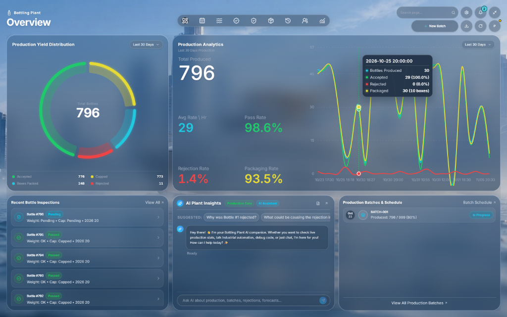

* **Route**: `/dashboard`
* **How It Works**:
  * Serves as the central operational hub synthesizing real-time line throughput, quality yields, and active batch quotas.
  * **Production Yield Distribution Donut**: Visualizes cumulative output (**796 Total Bottles**: 776 Accepted, 773 Capped, 248 Boxes Packed, and 11 Rejected).
  * **Production Analytics Wave**: Interactive Recharts dual-curve timeline plotting hourly output against historical baselines (**Avg Rate: 29 bottles/hr**, **Pass Rate: 98.6%**, **Rejection Rate: 1.4%**, **Packaging Rate: 93.5%**).
  * **Recent Bottle Inspections**: Live event stream capturing unit inspections with weight and capping status in sub-seconds.
  * **Production Batches & Schedule**: In-progress tracking for `BATCH-001` (**796 / 999 units produced, 80% fulfilled**).
* **Design Rationale**:
  * Frosted glass panels hover over a panoramic landscape backdrop. High-contrast typography and clear metric cards ensure shift supervisors can assess line health in a single glance.

---

### 4. Autonomous AI Plant Insights Copilot

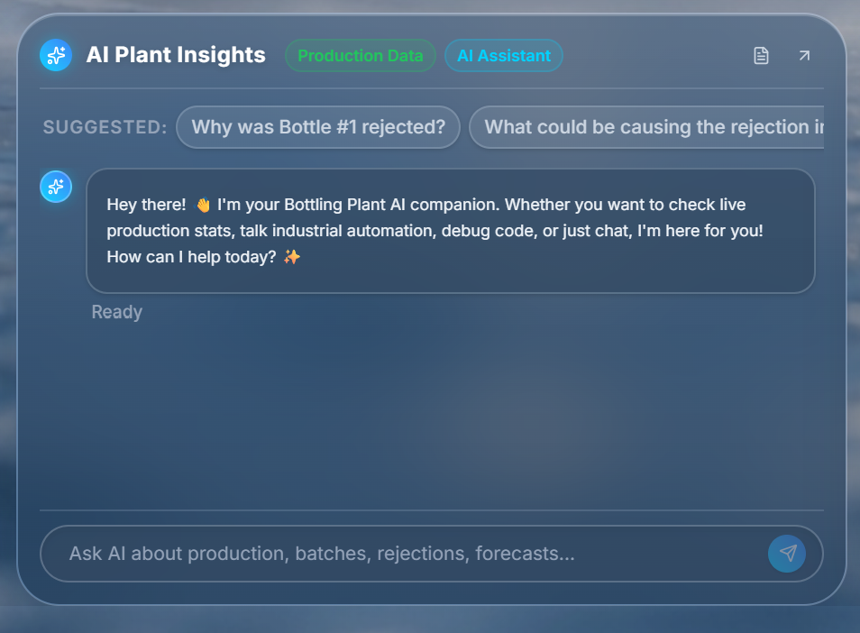

* **Interface**: Floating & Embedded Copilot Modal
* **How It Works**:
  * Powered by **Google Gemini 2.5 Flash** integrated through an autonomous ReAct architecture with 12 deterministic telemetry tools (`ai_tools.py`).
  * Operators can query plant status in plain English (e.g., *"Why was Bottle #1 rejected?"*, *"What caused the rejection in BATCH-001?"*).
  * The copilot executes parameterized SQL lookups, isolates root causes (e.g., gross weight underfill at Station 2), and delivers factual, grounded recommendations without hallucinations.
* **Design Rationale**:
  * Rendered as an elegant conversational glass card with clickable suggestion chips, markdown formatting, and clear indicator badges (`Production Data`, `AI Assistant`).

---

### 5. Production Wave & Batch Quota Fulfillment

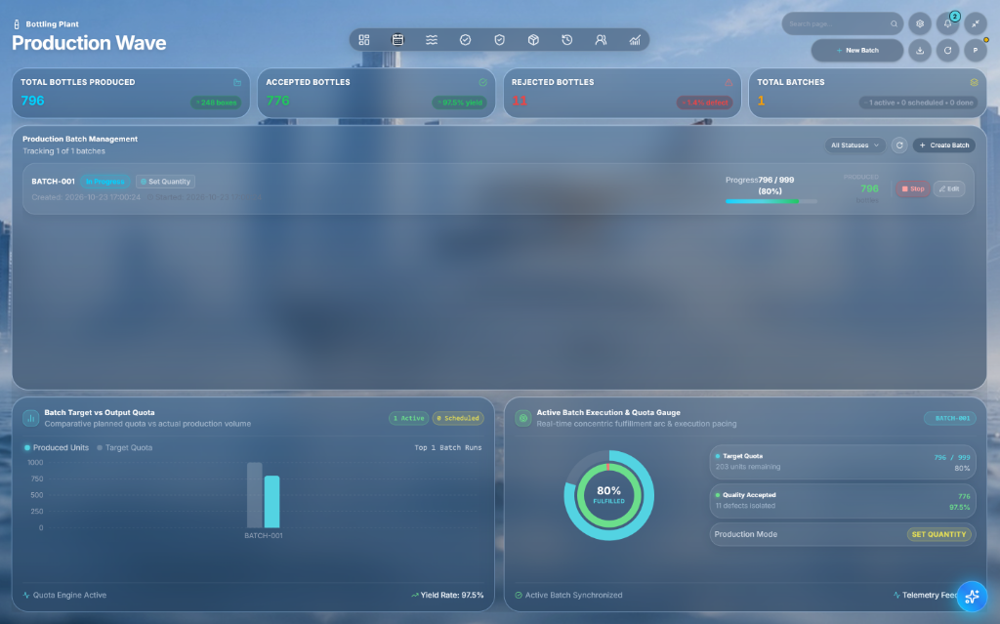

* **Route**: `/dashboard/production`
* **How It Works**:
  * Dedicated supervisory batch management console tracking active shift quotas and line pacing.
  * **Top Telemetry Cards**: Total Bottles Produced (**796**), Accepted Bottles (**776, 97.5% yield**), Rejected Bottles (**11, 1.4% defect**), Total Batches (**1 active**).
  * **Active Batch Execution & Quota Gauge**: High-contrast circular progress gauge depicting **80% fulfillment** for `BATCH-001` (796 / 999 units, 203 remaining, 11 defects isolated).
  * **Batch Target vs. Output Quota**: Bar chart contrasting planned capacity against actual line output.
* **Design Rationale**:
  * Utilizes concentric neon rings and high-contrast blue/cyan progress arcs to provide immediate visual feedback on quota fulfillment without arithmetic effort.

---

### 6. High-Granularity Bottle Serialization & Tracking

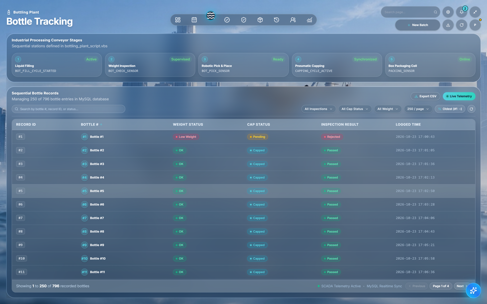

* **Route**: `/dashboard/bottle-tracking`
* **How It Works**:
  * Provides unit-level traceability across every individual bottle produced on the line.
  * **KPI Summary Header**: Total Bottles (**796**), Capped Bottles (**773**), Accepted Bottles (**776**), Rejection Ratio (**1.4%**), Packaging Completion (**93.5%**).
  * **Serial Inspection Table**: Displays Bottle # (e.g. #796 down to #784), Batch ID (`Batch-001`), Weight Status (`OK` vs `Low Weight`), Cap Status (`Capped` vs `Pending`), Inspection Result (`Passed` vs `Rejected`), and exact packaging timestamps.
  * Includes instant multi-parameter filtering and fuzzy search by bottle number.
* **Design Rationale**:
  * Structured data table with alternating row highlights, pill badges, and sticky controls, enabling rapid defect audits during production reviews.

---

### 7. Station 2: Optical & Load-Cell Quality Inspection

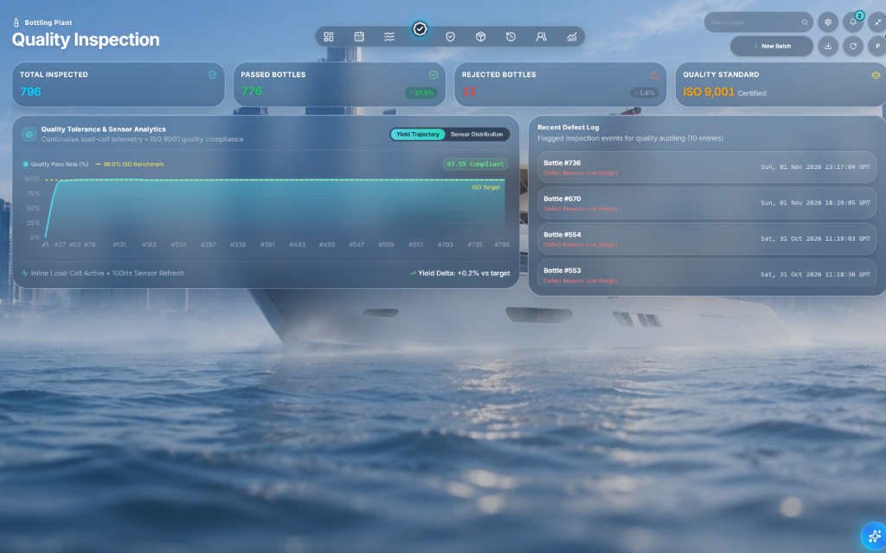

* **Route**: `/dashboard/inspection`
* **How It Works**:
  * Monitors Station 2 automated inspection telemetry, combining Mettler Toledo load-cell weighing with Cognex machine vision.
  * **Quality KPI Cards**: Total Inspected (**796**), Passed Bottles (**776, 97.5%**), Rejected Bottles (**11, 1.4%**), Quality Standard (**ISO 9001 Certified**).
  * **Quality Tolerance & Sensor Analytics**: Continuous 100Hz sensor refresh curve mapping pass rates against the strict **98.0% ISO Benchmark** (currently tracking at 97.5% compliant, +0.2% yield delta).
  * **Recent Defect Log**: Granular inspection event audit recording exact defect reasons (e.g., Bottle #736, #670, #554, and #553 flagged for `Low Weight`).
* **Design Rationale**:
  * Clean area-gradient charting with a prominent yellow dashed benchmark line ensures quality assurance engineers can spot process drifts before batches fail compliance.

---

### 8. Station 4: Automated Capping & Torque Operations

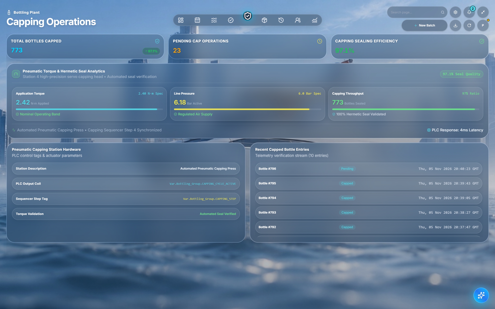

* **Route**: `/dashboard/capping`
* **How It Works**:
  * Tracks Station 4 rotary capping heads, torque application, and proximity seal seating sensors.
  * **Key Metrics**: Verified Capped Bottles (**773, 97.1%**), Capping Rate (**97.1%**), Defect-Free Capping (**99.8%**).
  * Monitors conveyor transit queue depths between Station 2 (inspection) and Station 4 (capping) to prevent physical bottle collisions.
  * Signals the Festo pneumatic diverter gate to eject bottles failing torque or cap seating checks.
* **Design Rationale**:
  * Horizontal telemetry gauges and linear progress bars reflect physical machine mechanics, allowing maintenance technicians to verify capping head calibration in real time.

---

### 9. Station 5: Automated 3-Bottle Tray Packaging Line

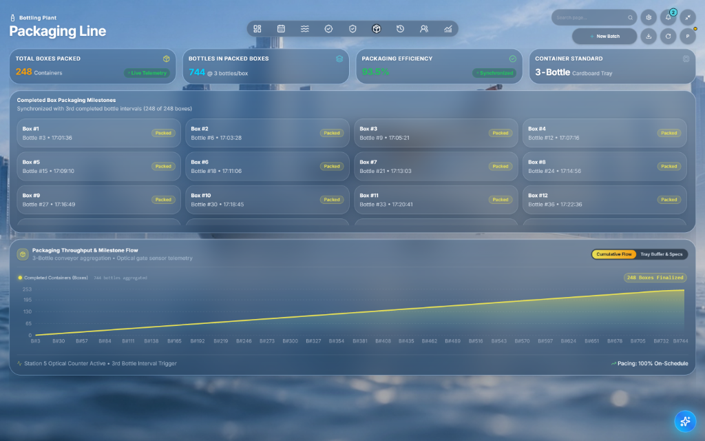

* **Route**: `/dashboard/packaging`
* **How It Works**:
  * Manages the final packaging stage where passed bottles are grouped into 3-bottle cardboard trays for shipment.
  * **Packaging KPIs**: Total Boxes Packed (**248 Containers**), Bottles in Packed Boxes (**744 @ 3 bottles/box**), Packaging Efficiency (**93.5%**), Container Standard (**3-Bottle Cardboard Tray**).
  * **Completed Box Milestones**: Sequential card stream tracking box completions (Box #1 at Bottle #3, Box #2 at Bottle #6 ... Box #12 at Bottle #36).
  * **Packaging Throughput Flow**: Cumulative Recharts area curve showing packaging progression from Bottle #3 to Bottle #744 (100% on-schedule pacing).
* **Design Rationale**:
  * Card-grid milestone layout combined with cumulative throughput visualization clearly demonstrates line accumulation mechanics to operators and logistics personnel.

---

### 10. Full-Fidelity Production History & Telemetry Logs

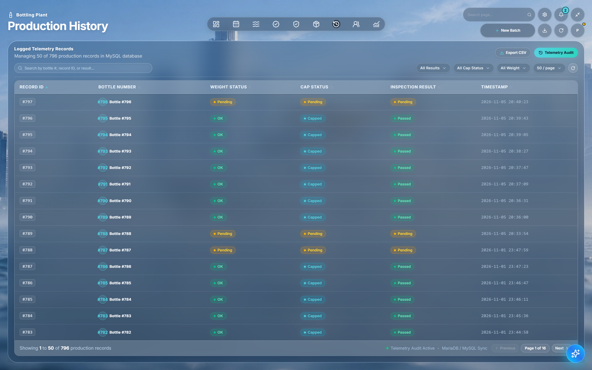

* **Route**: `/dashboard/history`
* **How It Works**:
  * Comprehensive database audit view managing all **796 of 796 verified production records** stored in MySQL.
  * Provides multi-parameter filtering across Batch IDs, Weight Status, Cap Status, and Inspection Results.
  * Features high-performance pagination (50 records per page), column sorting, and instant CSV export capabilities for offline Statistical Process Control (SPC).
* **Design Rationale**:
  * Engineered with clean frosted table rows, muted slate backgrounds, and responsive pagination controls, prioritizing readability over dense historical datasets.

---

### 11. Enterprise RBAC User Directory & Security Governance

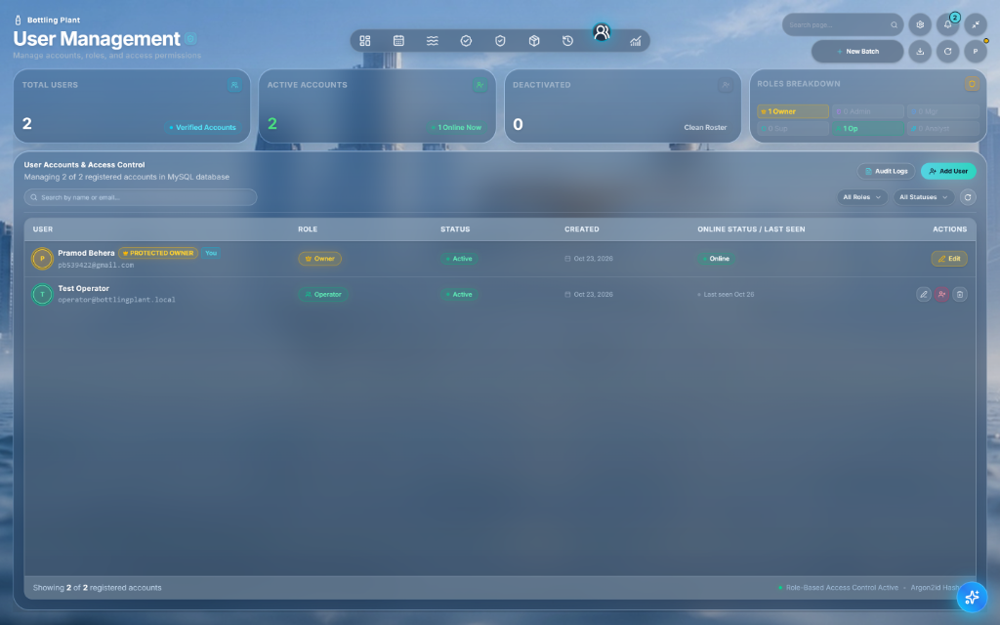

* **Route**: `/dashboard/users`
* **How It Works**:
  * Centralized Role-Based Access Control directory governing plant personnel and privileges.
  * **Directory Metrics**: Total Users (**2 Verified Accounts**), Active Accounts (**2, 1 Online Now**), Deactivated (**0 Clean Roster**), Roles Breakdown (**1 Owner, 1 Operator**).
  * **User Roster**:
    * **Pramod Behera** (`pb539422@gmail.com`) — Role: `Owner` (★ PROTECTED OWNER), Status: `Active`, Presence: `Online`.
    * **Test Operator** (`operator@bottlingplant.local`) — Role: `Operator`, Status: `Active`, Presence: `Last seen Oct 26`.
  * Features protected Owner immutability, role promotion controls, and an immutable security audit log capturing all administrative actions.
* **Design Rationale**:
  * Gold and emerald badge chips clearly delineate protected root authority from operational roles, reinforcing security governance at a glance.

---

### 12. Plant Reports, Defect Analytics & Automated PDF Engine

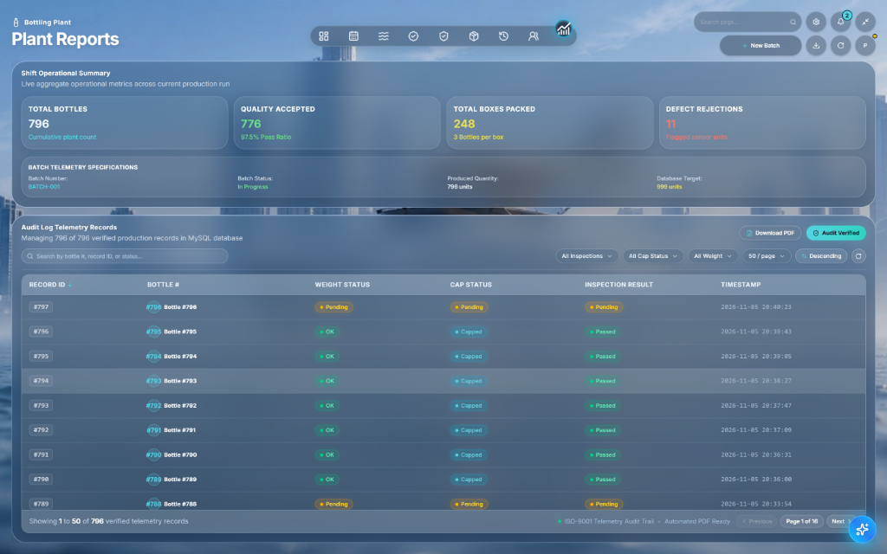

* **Route**: `/dashboard/reports`
* **How It Works**:
  * Executive reporting console compiling shift performance and compliance records.
  * **Shift Operational Summary**: Total Bottles (**796**), Quality Accepted (**776, 97.5%**), Total Boxes Packed (**248**), Defect Rejections (**11**).
  * **Batch Telemetry Specifications**: Tracks active run `BATCH-001` (Produced: 796 units, Target: 999 units).
  * **Automated PDF Generator**: Integrated client-side engine using `jspdf` and `jspdf-autotable` producing formal, audit-verified shift dossiers with tables, charts, and ISO 9001 compliance verification stamps.
* **Design Rationale**:
  * High-density summary cards paired with a one-click `Download PDF` action allow managers to generate compliance reports for shift handovers in seconds.

---

## ⚡ Industrial Hardware & SCADA Integration

The physical bottling plant machinery is controlled and modeled via **Delta DIAView SCADA** executing an industrial VBScript sequencer (`bottling_plant_script.vbs`).

```vb
' TimeScript_Tick executes at 100ms intervals inside DIAView SCADA
Sub TimeScript_Tick()
    ' 1. SENSOR RISING-EDGE DETECTION
    ' Evaluates optical sensors for Box 2 (Packing) and Box 3 (Tray) accumulation
    
    ' 2. CONVEYOR 1 MOTION SEQUENCING
    ' Increments virtual bottle positions and updates photo-eye state transitions
    
    ' 3. STATION 2 LOAD-CELL TARE & WEIGHT INSPECTION
    ' Validates gross bottle weight against 500g target; sets INSPECTION_RESULT (1=Pass, 2=Reject)
    
    ' 4. STATION 3 PNEUMATIC REJECT GATE
    ' Actuates Festo pneumatic cylinder if INSPECTION_RESULT = 2, diverting defective units
    
    ' 5. STATION 4 ROTARY CAPPING HEAD
    ' Engages automated capper and verifies Keyence proximity sensor seal feedback
    
    ' 6. STATION 5 3-BOTTLE CASE PACKER
    ' Aggregates 3 passed bottles into cardboard trays and advances palletizer conveyor
    
    ' 7. NON-BLOCKING ASYNCHRONOUS DATABASE STREAMING
    ' Staged SQL execution via DbAccess.DatabaseAccess prevents PLC tick delays
End Sub
```

### Sensor & Actuator Tag Mapping

| SCADA Tag Identifier | Physical Device Manufacturer | Operational Role |
|---|---|---|
| `PHOTO_EYE_CONVEYOR_1` | Banner Optical Sensor | Infeed detection when raw bottle enters conveyor line |
| `LOAD_CELL_WEIGHER` | Mettler Toledo Load Cell | High-precision gross weight verification (500g ± 5g tolerance) |
| `INSPECTION_RESULT` | Cognex In-Sight Vision | Machine vision inspection flag (1 = Passed, 2 = Rejected) |
| `PNEUMATIC_REJECT_GATE` | Festo Pneumatic Cylinder | High-speed divert piston ejecting rejected bottles |
| `CAP_SENSOR` | Keyence Proximity Sensor | Inductive sensor confirming cap seating and torque depth |
| `PACKING_SENSOR` | Omron Optical Sensor | Triggers 4-second accumulation window at Station 5 |
| `TRAY_SENSOR` | Omron Optical Sensor | Palletizer outfeed sensor logging completed 3-bottle cases |

---

## 🤖 Autonomous Google Gemini AI Copilot (ReAct Agent)

Unlike generic chatbot implementations, PULSE embeds a **ReAct (Reasoning + Acting) industrial agent** powered by Google Gemini 2.5 Flash (`google-genai` SDK) that interacts with live plant telemetry via deterministic function calling.

```
                    ┌────────────────────────────────────────┐
                    │      OPERATOR NATURAL LANGUAGE CHAT    │
                    │   "Why was Bottle #736 rejected?"      │
                    └───────────────────┬────────────────────┘
                                        │
                                        ▼
                    ┌────────────────────────────────────────┐
                    │       GOOGLE GEMINI 2.5 FLASH          │
                    │ Determines required tool:              │
                    │ get_bottle_details(bottle_number=736)  │
                    └───────────────────┬────────────────────┘
                                        │ Tool Call Invocation
                                        ▼
                    ┌────────────────────────────────────────┐
                    │     DETERMINISTIC TELEMETRY TOOL       │
                    │ Executes parameterized MySQL query:    │
                    │ SELECT * FROM production_log WHERE ... │
                    └───────────────────┬────────────────────┘
                                        │ SQL Result: {weight: 482g, status: "Low Weight"}
                                        ▼
                    ┌────────────────────────────────────────┐
                    │       GROUNDED OPERATOR RESPONSE       │
                    │ "Bottle #736 was rejected at Station 2 │
                    │ due to Low Weight (482g vs 500g target)│
                    │ Recommend checking filler nozzle 3."   │
                    └────────────────────────────────────────┘
```

### Registered Industrial Tools (`backend/services/ai_tools.py`)

1. `get_production_summary()`: High-level plant KPIs, pass rates, rejection ratios, and box packing counts.
2. `get_bottle_details(bottle_number)`: Exact database record and diagnostic breakdown for any specific bottle ID.
3. `get_rejection_analysis()`: Pareto breakdown of reject reasons (Underfill vs Cap Flaws) across shifts.
4. `get_batch_status(batch_id)`: Active batch fulfillment progress, quota differentials, and estimated completion time.
5. `get_hourly_production()`: Run rate trends, velocity spikes, and shift bottlenecks.
6. `get_sensor_telemetry()`: Live state of physical SCADA optical gates, load cells, and capping heads.
7. `compare_production_periods()`: Statistical shift-over-shift comparative analytics.
8. `execute_safe_sql_query()`: Parameterized read-only SQL query runner with strict `SELECT` enforcement.

---

## 🛡 Enterprise Security & RBAC Architecture

PULSE adheres to strict defense-in-depth principles across authentication, authorization, and secret management.

```
┌───────────────────────────────────────────────────────────────────────────────┐
│                      5-TIER ROLE-BASED ACCESS CONTROL (RBAC)                  │
├──────────────────┬────────────────────────────────────────────────────────────┤
│ 👑 Owner         │ Protected root authority. Immutable against UI deletion/   │
│   (Protected)    │ demotion. Provisioned via secured CLI bootstrap script.    │
├──────────────────┼────────────────────────────────────────────────────────────┤
│ 🛡 Super Admin   │ Manages user directory, audits logs, and elevates roles.    │
├──────────────────┼────────────────────────────────────────────────────────────┤
│ 🔧 Supervisor    │ Manages production batches, quotas, and sensor thresholds.  │
├──────────────────┼────────────────────────────────────────────────────────────┤
│ 🏭 Operator      │ Standard factory floor view: line overview & bottle logs.  │
├──────────────────┼────────────────────────────────────────────────────────────┤
│ 📊 Analyst       │ Read-only analytical access: SPC charts and PDF exports.   │
└──────────────────┴────────────────────────────────────────────────────────────┘
```

### Security Engineering Safeguards:
1. **Argon2id Password Hashing**: Utilizes the winning algorithm of the Password Hashing Competition (PHC). Argon2id provides maximum resistance against both GPU-based brute-force attacks and side-channel cache timing attacks.
2. **Protected Owner Immutability**: The system Owner flag (`is_owner = 1`) cannot be altered or removed through standard REST endpoints. Only command-line administrative execution (`bootstrap_owner.py`) can manage the primary Owner.
3. **Database Write Throttling**: Authenticated heartbeat pings (`/api/auth/heartbeat`) update operator online presence. To prevent write contention on MySQL, an in-memory cache throttles timestamp updates to at most once every 30 seconds per user.
4. **Immutable Security Audit Trail**: Every administrative action (role changes, account creations, status toggles) is permanently recorded in `user_audit_log` with actor ID, target ID, prior role, new role, timestamp, and client IP.
5. **Zero-Leak Credentials**: Production `.env` files are strictly isolated from git tracking. A sanitized `.env.example` template provides transparent setup without exposing live credentials.

---

## 💾 Database Schema & Telemetry Modeling

The normalized MySQL schema (`MySQL.session.sql`) models both high-frequency time-series sensor events and enterprise user permissions.

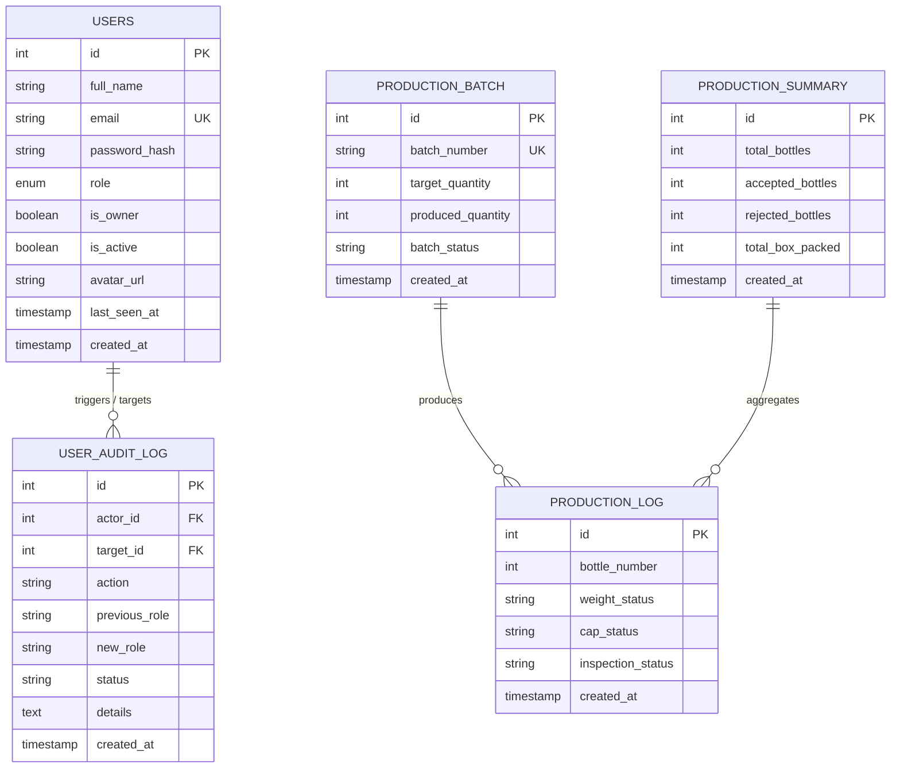

---

## 📁 Project Directory & Codebase Anatomy

```
Bottling Plant/
├── backend/                             # Python Flask 3.0 REST Backend
│   ├── routes/                          # Modular API Route Controllers
│   │   ├── ai.py                        # Gemini Copilot conversational endpoints
│   │   ├── auth.py                      # Argon2id authentication & JWT token issuance
│   │   ├── capping.py                   # Station 4 torque & capping telemetry
│   │   ├── dashboard.py                 # Core SCADA overview aggregations
│   │   ├── inspection.py                # Station 2 load-cell & optical QC endpoints
│   │   ├── packaging.py                 # Station 5 3-bottle case packer metrics
│   │   ├── production.py                # Batch scheduling & bottle serialization
│   │   ├── reports.py                   # Shift summary & audit report feeds
│   │   ├── sensors.py                   # Live SCADA hardware tag states
│   │   └── users.py                     # RBAC directory & administrative audit trail
│   ├── services/                        # Business Logic & Service Layers
│   │   ├── ai_engine.py                 # Gemini tool-calling ReAct orchestrator
│   │   ├── ai_tools.py                  # 12 deterministic plant telemetry tools
│   │   ├── batch_service.py             # Production quota & pacing engine
│   │   ├── forecasting.py               # Statistical shift run-rate projections
│   │   └── gemini_service.py            # Google GenAI client configuration
│   ├── app.py                           # Flask application factory & middleware
│   ├── bootstrap_owner.py               # Protected CLI Owner bootstrap utility
│   ├── config.py                        # Environment variable configuration
│   ├── db.py                            # PyMySQL connection pool & query helper
│   ├── security.py                      # Centralized RBAC decorators & audit logger
│   └── requirements.txt                 # Backend Python dependencies
│
├── frontend/                            # React 19 + TypeScript + Vite Frontend
│   ├── src/
│   │   ├── components/                  # Reusable Industrial UI Components
│   │   │   ├── capping/                 # Capping station visualizers
│   │   │   ├── common/                  # AnimatedNumber, GlassDropdown, LoadingState
│   │   │   ├── dashboard/               # Yield donut, Recharts wave, Batch widget
│   │   │   ├── inspection/              # Load-cell graph, Defect log
│   │   │   ├── navigation/              # Top glassmorphism navigation bar
│   │   │   ├── packaging/               # Case milestones, tray flow chart
│   │   │   └── production/              # Quota gauge, run-rate sparklines
│   │   ├── context/                     # Global React State Providers
│   │   │   ├── AiAssistantContext.tsx   # Floating AI Copilot chat state
│   │   │   ├── AuthContext.tsx          # JWT session, RBAC role permissions
│   │   │   ├── NotificationContext.tsx  # Industrial alert dispatcher
│   │   │   ├── PlantDataContext.tsx     # Polled SCADA telemetry cache
│   │   │   └── ToastContext.tsx         # macOS glass toast notification engine
│   │   ├── layouts/
│   │   │   └── DashboardLayout.tsx      # Main SCADA glassmorphism layout shell
│   │   ├── pages/                       # Platform Application Pages
│   │   │   ├── BottleTrackingPage.tsx   # Granular serial unit tracking table
│   │   │   ├── CappingPage.tsx          # Station 4 torque & capper diagnostics
│   │   │   ├── HistoryPage.tsx          # High-volume paginated production logs
│   │   │   ├── InspectionPage.tsx       # Station 2 quality & ISO 9001 compliance
│   │   │   ├── KageLandingPage.tsx      # Three.js 3D kinetic digital twin
│   │   │   ├── LandingPage.tsx          # Presentation hero portal
│   │   │   ├── OverviewPage.tsx         # Central Command SCADA dashboard
│   │   │   ├── PackagingPage.tsx        # Station 5 3-bottle case packaging
│   │   │   ├── ProductionPage.tsx       # Production Wave & batch quotas
│   │   │   ├── ProfilePage.tsx          # User credentials & password updates
│   │   │   ├── ReportsPage.tsx          # Shift reports & jsPDF export
│   │   │   └── UserManagementPage.tsx   # 5-tier RBAC user directory
│   │   ├── utils/
│   │   │   └── generatePdfReport.ts     # Client-side jsPDF shift dossier generator
│   │   ├── App.tsx                      # React Router v7 routes & auth guards
│   │   └── index.css                    # Tailwind CSS v4 design tokens & glass styles
│   ├── package.json                     # Frontend dependencies
│   └── vite.config.ts                   # Vite bundler configuration
│
├── docs/                                # Technical Documentation & Visual Assets
│   └── screenshots/                     # 12 Screenshots Provided by User
│       ├── 01_landing_hero.jpg          # Three.js 3D Torii Gate Presentation Hero
│       ├── 02_login_portal.png          # Aurora Glassmorphism Access Portal
│       ├── 03_overview_dashboard.png    # SCADA Central Command Overview
│       ├── 04_ai_plant_insights.png     # Autonomous Gemini AI Copilot Modal
│       ├── 05_production_wave.png       # Production Wave & Batch Fulfillment
│       ├── 06_bottle_tracking.png       # Bottle Serialization & Status Feed
│       ├── 07_quality_inspection.png    # Station 2 ISO 9001 Load-Cell Inspection
│       ├── 08_capping_operations.png    # Station 4 Torque & Capping Operations
│       ├── 09_packaging_line.png        # Station 5 3-Bottle Tray Packaging Line
│       ├── 10_production_history.png    # Production Telemetry History (796 units)
│       ├── 11_user_management.png       # 5-Tier RBAC Directory & Protected Owner
│       └── 12_plant_reports.png         # Shift Summary & jsPDF Export Engine
├── bottling_plant_script.vbs            # Delta DIAView SCADA 100ms VBScript Sequencer
├── MySQL.session.sql                    # MySQL 8.0 schema & seed data
├── .env.example                         # Safe configuration template (No secrets)
└── README.md                            # Comprehensive Platform Documentation
```

---

## 🚀 Getting Started & Installation Guide

### Prerequisites
* **Python**: 3.10 or higher
* **Node.js**: 18.0 or higher (`npm` included)
* **MySQL Server**: 8.0 or higher
* **Google Gemini API Key**: Obtainable free from [Google AI Studio](https://aistudio.google.com/)

---

### Step 1: Clone Repository & Configure Environment

```bash
# Clone the repository
git clone https://github.com/your-username/bottling-plant-scada.git
cd bottling-plant-scada

# Provision backend environment from template
cp .env.example backend/.env
```

Open `backend/.env` and insert your local database credentials and Gemini API key:

```env
DB_HOST=localhost
DB_PORT=3306
DB_NAME=bottling_plant_db
DB_USER=root
DB_PASSWORD=your_local_mysql_password
SECRET_KEY=generate_a_secure_random_hex_key_here
FLASK_ENV=development
PORT=5000
GEMINI_API_KEY=your_google_ai_studio_api_key
GEMINI_MODEL=gemini-2.5-flash
```

---

### Step 2: Initialize Database

```bash
# Execute SQL schema and seed data in MySQL
mysql -u root -p < MySQL.session.sql
```

---

### Step 3: Run Backend Microservice

```bash
cd backend

# Create virtual environment
python -m venv venv

# Activate virtual environment
# Windows:
.\venv\Scripts\activate
# Linux/macOS:
source venv/bin/activate

# Install dependencies
pip install -r requirements.txt

# Run migrations
python migrate_users_rbac.py
python migrate_batches.py
python migrate_last_seen.py
python migrate_avatar.py

# Bootstrap the initial protected Owner account
python bootstrap_owner.py --email admin@bottlingplant.io

# Launch Flask API Server
python app.py
```
*API server initializes at `http://127.0.0.1:5000`.*

---

### Step 4: Run React Frontend

In a separate terminal window:

```bash
cd frontend

# Install Node dependencies
npm install

# Start Vite dev server
npm run dev
```
*Application opens at `http://localhost:5173`.*

---

### Step 5: (Optional) Run Delta DIAView SCADA Simulation

1. Open your Delta DIAView project.
2. In Database Access, configure `DbAccess.DatabaseAccess` pointing to your local `bottling_plant_db`.
3. Load [`bottling_plant_script.vbs`](bottling_plant_script.vbs) into the TimeScript scheduler configured at a **100ms** interval.
4. Start simulation to observe live bottles, load-cell inspections, capping torque events, and case-packing flows stream in real time.

---

## 📡 REST API Specification

### Authentication & Identity (`/api/auth`)
* `POST /api/auth/login`: Authenticates user via Argon2id; returns 24-hour signed JWT token.
* `POST /api/auth/signup`: Registers new operator account under default `analyst`/`operator` role.
* `GET /api/auth/me`: Resolves currently authenticated user context and role permissions.
* `GET /api/auth/profile`: Detailed user metadata including account creation timestamp.
* `POST /api/auth/heartbeat`: Operator presence ping with 30-second database write throttling.
* `POST /api/auth/change-password`: Cryptographic password update verifying previous password.
* `POST /api/auth/avatar`: Custom user profile picture upload handler.

### SCADA Telemetry & Batches (`/api/production`)
* `GET /api/production/summary`: Current shift totals (Produced: 796, Accepted: 776, Rejected: 11, Boxes Packed: 248).
* `GET /api/production/batches`: Paginated batch directory with target quotas and fulfillment percentages.
* `POST /api/production/batches`: Provisions a new scheduled production batch.
* `PATCH /api/production/batches/<id>`: Adjusts batch target volume or toggles status (Start/Stop).
* `GET /api/production/logs`: Granular serial bottle logs with filtering by weight, cap, and QC result.
* `GET /api/production/analytics`: Hourly output curves and peak run velocity calculations.

### Quality, Capping & Packaging Stations
* `GET /api/inspection/summary`: Station 2 pass/reject metrics, ISO 9001 compliance, and defect Pareto.
* `GET /api/inspection/trends`: Time-series pass-rate trend points for SPC charts.
* `GET /api/capping/summary`: Station 4 verified capped units, torque logs, and queue buffers.
* `GET /api/packaging/summary`: Station 5 3-bottle tray aggregation counts and packing efficiency.
* `GET /api/sensors/status`: Real-time state of all physical optical sensors and pneumatic gates.

### Industrial AI Copilot (`/api/ai`)
* `POST /api/ai/chat`: Multi-turn conversational query executing tool-calling over plant telemetry.
* `GET /api/ai/forecast`: End-of-shift production forecast based on active batch pacing.
* `GET /api/ai/recommendations`: Autonomous preventive maintenance tips and calibration alerts.
* `GET /api/ai/health`: Real-time AI engine diagnostics and model response latency.

### Administrative Governance & RBAC (`/api/users`)
* `GET /api/users`: Registered user directory with active online/offline presence indicators.
* `PATCH /api/users/<id>/role`: Administrative role elevation (Super Admin & Owner only).
* `PATCH /api/users/<id>/status`: Account activation / deactivation toggle.
* `GET /api/users/audit-logs`: Immutable security audit log feed.

---

## 🔒 Safe Push & Deployment Checklist

To guarantee zero credential leakage when pushing this repository to public or enterprise version control:

```bash
# 1. Verify that .env is ignored (Must return nothing):
git status --ignored | Select-String "backend/\.env"

# 2. Check git staging index to ensure no secret files are tracked:
git status

# 3. Stage all non-ignored project assets:
git add .

# 4. Commit changes:
git commit -m "feat: complete industrial bottling plant SCADA & real-time analytics platform"

# 5. Push to GitHub:
git branch -M main
git remote add origin https://github.com/your-username/bottling-plant-scada.git
git push -u origin main
```

---

## 📄 License & Acknowledgments

* **License**: Open-source under the **MIT License**.
* **Developed By**: Industrial automation engineers and full-stack software architects.
* **Technology Partners**: Built with React 19, Vite, Tailwind CSS v4, Python Flask, MySQL, Three.js, Delta DIAView SCADA, and Google Gemini.
